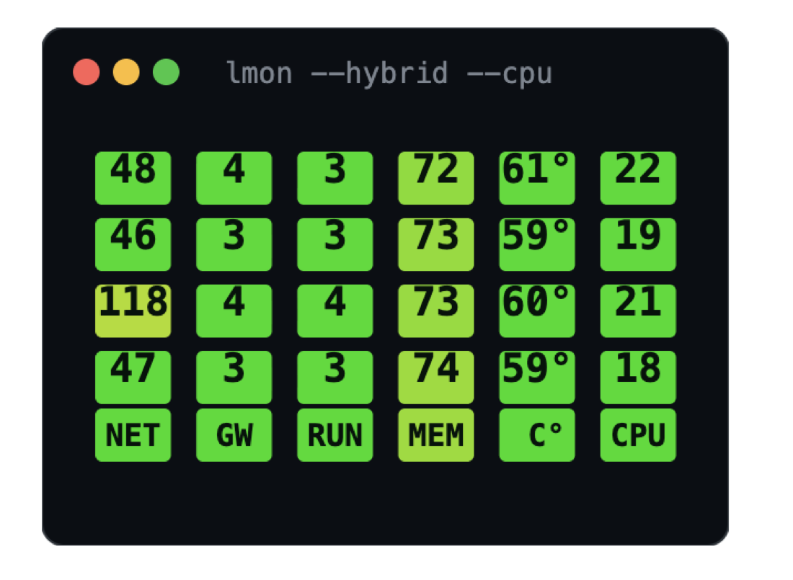
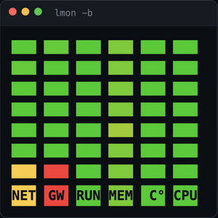
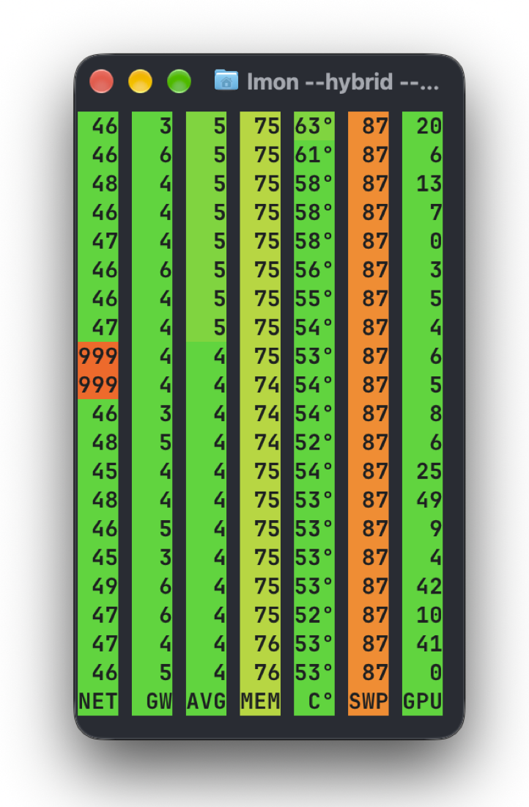
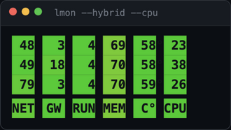

# lmon

**English** · [По-русски / Russian](README.ru.md) · [Website](https://martiyanov.github.io/lmon/)

<p align="center">
  <a href="https://martiyanov.github.io/lmon/"></a>
  &nbsp;
  <a href="https://martiyanov.github.io/lmon/"></a>
  &nbsp;
  <a href="https://martiyanov.github.io/lmon/"></a>
</p>
<p align="center"><sub>Three display modes — plain digits, color blocks (<code>-b</code>) and hybrid (<code>--hybrid</code>) — real values captured on macOS. The window can shrink to the width of the indicators:</sub></p>
<p align="center">
  <a href="https://martiyanov.github.io/lmon/"></a>
</p>

Ever want to just know your machine is okay — without opening a task
manager or giving half your screen to graphs? lmon answers that with
one line per second. Color carries the status: green means calm,
red means look. You don't even need to read the numbers — a glance is
enough, which is why the header ribbon is pinned to the bottom and
painted with each column's current state.

A stream of measurements — ping to the internet, ping to your gateway,
load average, memory pressure and CPU temperature — colored green / yellow /
red so you can spot trouble at a glance.

The header is pinned to the bottom; each label sits on a background
colored by that column's current state, so the status line stays
readable even in a 2-line window:

```
 12   2   1  62  55       ← values stream upward
 11   2   1  63  55
118   3   1  63  56       ← Wi-Fi hiccup, gateway is fine → it's the uplink
NET  GTW RUN MEM  C°       ← pinned header, label background = state color
```

Single static binary for **macOS**, **Linux** and **Windows 10+**
(amd64/arm64), written in Go. The original zsh version is kept in
[legacy/](legacy/lmon.zsh). Design principles: see
[CONCEPT.md](CONCEPT.md).

## Install

**macOS (Homebrew)**:

```sh
brew install martiyanov/tap/lmon
```

**macOS** (без Homebrew, Apple Silicon):

```sh
curl -fsSL https://github.com/martiyanov/lmon/releases/latest/download/lmon_darwin_arm64.tar.gz | tar -xz
sudo mv lmon /usr/local/bin/
```

On an Intel Mac use `lmon_darwin_amd64.tar.gz`.

**Debian / Ubuntu** (and other `.deb` systems):

```sh
curl -fsSLO https://github.com/martiyanov/lmon/releases/latest/download/lmon_amd64.deb
sudo dpkg -i lmon_amd64.deb
```

On ARM machines use `lmon_arm64.deb`. Fedora/RHEL: pick the `.rpm` asset
from the [releases page](https://github.com/martiyanov/lmon/releases).

**Other Linux**:

```sh
curl -fsSL https://github.com/martiyanov/lmon/releases/latest/download/lmon_linux_amd64.tar.gz | tar -xz -C /tmp
sudo mv /tmp/lmon /usr/local/bin/
```

**Windows 10+** (PowerShell):

```powershell
curl.exe -fsSL -o lmon.zip https://github.com/martiyanov/lmon/releases/latest/download/lmon_windows_amd64.zip
Expand-Archive lmon.zip; Move-Item lmon\lmon.exe "$env:LOCALAPPDATA\Microsoft\WindowsApps" -Force
```

(then run `lmon` in Windows Terminal; on ARM use `lmon_windows_arm64.zip`).
On Windows the `L` (load average), `T` (CPU temperature) and `I` (iowait)
columns are hidden automatically — the OS has no such readings. `SWP` reads
the page file through PDH (no admin), `GPU`/`G°` use NVIDIA NVML/nvidia-smi
or PDH GPU Engine counters (other vendors). CPU temperature has no native
API: pass `--temp-cmd` (e.g. LibreHardwareMonitor via PowerShell) to show
`C°`. At startup lmon says what was hidden or unavailable and how to fix it;
hints never block the run and can be turned off with `--no-hints`.

### Diagnostics on Windows

If a column shows `·` or `999`, run these in PowerShell and attach the output to a bug report:

```powershell
lmon --version
lmon --once --cols NGSPH --swap --gpu --gputemp

# is the --temp-cmd wiring alive? (expect 55)
lmon --once --cols T --temp-cmd "echo 55"

# swap / page file
Get-CimInstance Win32_PageFileUsage | Select-Object Name, AllocatedBaseSize, CurrentUsage

# network and gateway
ping -n 2 -w 1000 8.8.8.8
(Get-NetRoute -DestinationPrefix 0.0.0.0/0 | Sort-Object RouteMetric | Select-Object -First 1).NextHop

# GPU: NVIDIA driver tools, then WDDM counters (any vendor)
nvidia-smi --query-gpu=temperature.gpu,utilization.gpu --format=csv,noheader
Get-Counter '\GPU Engine(*)\Utilization Percentage' -ErrorAction SilentlyContinue

# disk pressure (counter names are localized on non-English Windows)
typeperf "\PhysicalDisk(_Total)\Avg. Disk Queue Length" -sc 3
typeperf "\PhysicalDisk(_Total)\Avg. Disk sec/Read" -sc 3

# CPU temperature sources (optional; often needs admin / may be unsupported)
Get-CimInstance -Namespace root/wmi -ClassName MSAcpi_ThermalZoneTemperature
```

What the values mean:

- **`SWP`** — page file usage, %. `·` means the page file is disabled or unreadable: enable it in `sysdm.cpl` → Advanced → Performance → Virtual memory.
- **`GPU`** — NVIDIA via NVML/nvidia-smi, AMD/Intel via PDH GPU Engine counters; `·` means no driver/source.
- **`G°`** — NVIDIA only for now; AMD/Intel need an external monitor.
- **`C°`** — no native Windows API; pass `--temp-cmd` (LibreHardwareMonitor, HWiNFO, ACPI WMI, any command printing °C).
- **`NET`/`GTW = 999`** — ICMP echo is not getting through; the startup hint shows the firewall rule and `--target`/`--gw` options.
- **`RUN` and `IOW`** are hidden on Windows on purpose: the OS has no load average and no iowait.

Also include your Windows version, GPU vendor and whether `nvidia-smi` exists — that is enough to reproduce most reports.

**If you have Go 1.22+**:

```sh
go install github.com/martiyanov/lmon@latest
```

All binaries are static, no dependencies beyond the system `ping`.

**Requirements:** the system `ping` utility (used as-is, no root needed).
On macOS the temperature column additionally needs
[`smctemp`](https://github.com/holtmann/osx/tree/master/smctemp)
(optional — without it the column shows `·` and lmon suggests installing it).
On Linux the temperature is read from
sysfs (`hwmon` / `thermal_zone`), no extra tools required.

## Usage

```sh
lmon                    # run forever, one line per second
lmon 20                 # print 20 lines and exit
lmon -b                 # color blocks instead of digits
lmon --cpu --swap       # add extra columns
lmon --no-hints         # start without hints about hidden columns
lmon help               # built-in reference (English; Russian via --lang ru
                        # or automatically on a Russian locale)
lmon --version          # version
```

### Columns

The base set is always shown; extra columns are enabled with flags:

Column letters are used in `--cols`; headers are three letters wide and
align exactly with the values. In plain words:

- **NET** — how fast the internet answers (ping to 8.8.8.8), ms.
- **GTW** — how fast your router answers. Both NET and GTW red — trouble at
  home (Wi-Fi, router, cable); only NET red — trouble at the provider.
- **RUN** — how many programs on average are queuing for the CPU (the
  classic "load average"). Up to 4 is calm, more means the machine is
  overloaded with work. Hidden on Windows (no such reading).
- **MEM** — used memory, %. Red MEM with a growing SWP — memory is short,
  things start to slow down.
- **C°** — CPU temperature. Above 80–90 °C it is overheating.
- **CPU** — how busy the processor is right now, % (`--cpu`).
- **IOW** — how much the CPU idles waiting for the disk (`--iowait`,
  Linux only; high — the disk is the bottleneck; hidden on macOS/Windows).
- **SWP** — swap/pagefile in use (`--swap`; grows when memory runs out). On Windows it reads the page file through PDH, no admin needed.
- **I/O** — how busy the disk is, % (`--disk-busy`, Windows; the closest thing
  to Linux iowait: reads `\PhysicalDisk(_Total)\% Disk Time` via PDH, no admin).
- **DSK** — how full the system disk is (`--disk`; above 90% — time to clean).
- **BAT** — battery charge (`--batt`; red below 20%).
- **GPU** — how busy the video card is, % (`--gpu`). Windows: NVML/nvidia-smi (NVIDIA) or PDH GPU Engine counters (other vendors).
- **G°** — GPU temperature (`--gputemp`; hidden on macOS/Windows — no
  unprivileged source).

`999` — the host is not answering, `·` — the sensor exists but is
unavailable right now (e.g. TMP without `smctemp`), `+++` — the value did
not fit the column. Columns that the OS cannot provide at all are hidden.

Thresholds (green ≤ / yellow ≤ / red beyond):

| Id | Green | Yellow | Red |
|----|-------|--------|-----|
| `N` NET | ≤ 50 ms | ≤ 150 ms | > 150 |
| `G` GTW | ≤ 10 ms | ≤ 50 ms | > 50 |
| `L` RUN | ≤ cores | ≤ 2× cores | > 2× cores |
| `M` MEM | ≤ 60 | ≤ 85 | > 85 |
| `T` C° | ≤ 60 | ≤ 75 | > 75 |
| `C` CPU | ≤ 50 | ≤ 80 | > 80 |
| `I` IOW | ≤ 5 | ≤ 20 | > 20 |
| `S` SWP | ≤ 30 | ≤ 70 | > 70 |
| `U` DSK | ≤ 80 | ≤ 90 | > 90 |
| `K` I/O | ≤ 60 | ≤ 85 | > 85 |
| `B` BAT | ≥ 50 | ≥ 20 | < 20 |
| `P` GPU | ≤ 50 | ≤ 85 | > 85 |
| `H` G° | ≤ 60 | ≤ 80 | > 80 |

RUN thresholds scale with the machine's core count (load average is a queue
length: "all cores busy" is still green). Override any column with
`--thresholds NET=100/200/500,RUN=8/16/32` — handy on mobile internet.

### Ping any host as a column

`--ping NAME=host` adds your own ping column (2–3 char name) — e.g. the
server inside your VPN tunnel: `--ping VPN=10.8.0.1`. While the tunnel is
up you get its latency; VPN down — the column shows `999`. Repeatable,
or via `LMON_PING="VPN=10.8.0.1,DNS=1.1.1.1"`.

By default the column is appended on the right. To place it anywhere, add
the name to `--cols`: `--cols NG,VPN,M` puts the VPN ping between the
gateway and memory. Separators are required around ping names (commas,
spaces or `+`); compact column sets like `NGM` still work.

### Blocks mode

`lmon --hybrid` combines both: exact digits printed on the state-colored
background (the bottom ribbon look, but in the data stream).

`lmon -b` (`--blocks`) replaces digits with colored squares `███` —
one per column, with a continuous green → yellow → red gradient along
each column's scale. You read the status with peripheral vision instead
of parsing numbers. A dim square (or `·`) means no sensor on this
machine; `999` means the host is unreachable.

### Reading bad numbers

- NET and GTW red together — local problem: Wi-Fi, router, cable.
  Only NET red — the uplink or your provider.
- RUN high while CPU is low — the system waits (disk, network, locks)
  rather than computes; high IOW confirms it's the disk (Linux).
- MEM red and SWP growing — out of memory, swapping started; everything
  slows down.
- CPU ≈ 100 for a long time — a process is eating the CPU; find it
  with `top`.
- C° > 80–90 °C — overheating/throttling: dust, fans, sustained load.
- DSK > 90 — the disk is nearly full; the system misbehaves.

### Options (flags and environment variables)

| Flag | Env | Default | Description |
|------|-----|---------|-------------|
| `--target` | `LMON_TARGET` | `8.8.8.8` | external host: IPv4, DNS name or an IPv6 literal (e.g. `fe80::1%en0`; the gateway follows the same address family) |
| `--gw` | `LMON_GW` | auto-detect | your gateway |
| `--interval` | `LMON_INTERVAL` | `1` | seconds between lines (fractional ok) |
| `-b`, `--blocks` | — | off | color blocks instead of digits |
| `--hybrid` | — | off | digits on the state-colored background |
| `--cols` | `LMON_COLS` | base set | column set and order: letters (`NG,CSB`) and `--ping` names (`NG,VPN,M`); flags add more |
| `--once` | — | off | print one line of values and exit; colored only on a terminal (tmux/scripts get plain text) |
| `--temp-cmd` | `LMON_TEMP_CMD` | — | external command printing CPU temp in °C (e.g. LibreHardwareMonitor via PowerShell on Windows) |
| `--disk-busy` | `LMON_DISK_BUSY` | off | disk busy time %, Windows (PDH `PhysicalDisk`) |
| `--cpu` `--iowait` `--swap` `--disk` `--batt` `--gpu` `--gputemp` | — | off | add extra columns |

```sh
lmon --target 1.1.1.1 --interval 2 10
lmon -b --cols TNGC --cpu          # own set and order, flags add more
lmon --ping VPN=10.8.0.1 --cols NG,VPN,M  # place a ping column anywhere
tmux: set -g status-right '#(lmon --once --cols=NGMC)'
```

The first line after start may show an inflated ping: the Wi-Fi radio
needs to wake up. Values settle after that.

## How it works

Ping runs through the system `ping` binary (flags adapted per OS), so no
privileges are required. Load average comes from the kernel (`sysctl` on
macOS, `/proc/loadavg` on Linux). Memory: `vm_stat` on macOS,
`/proc/meminfo` on Linux. GPU: `ioreg` on macOS, `nvidia-smi`/sysfs on
Linux. Colors respect `NO_COLOR`.

## A beginner-friendly Russian README

Установка и объяснения для тех, кому проще по-русски: [README.ru.md](README.ru.md).

## Community

- **GitHub Discussions** — ideas, questions, setups, release announcements: https://github.com/martiyanov/lmon/discussions
- Rules and how an idea becomes a feature: [COMMUNITY.md](COMMUNITY.md)
- Bugs and concrete tasks: [Issues](https://github.com/martiyanov/lmon/issues)
- Security reports: privately via [Security → Report a vulnerability](https://github.com/martiyanov/lmon/security/advisories/new)

Russian and English are both welcome. Answers worth keeping stay in Discussions so they remain searchable; Matrix/Telegram chat links will be added here once the rooms are created.

## License

[MIT](LICENSE)
