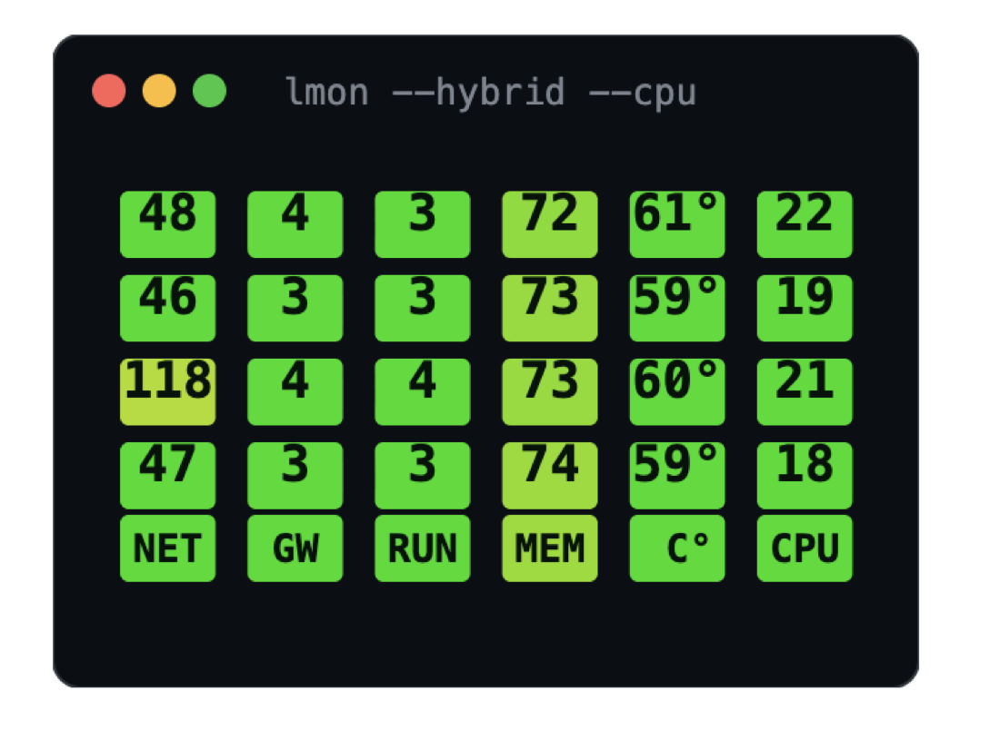
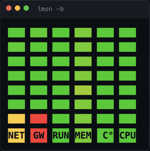
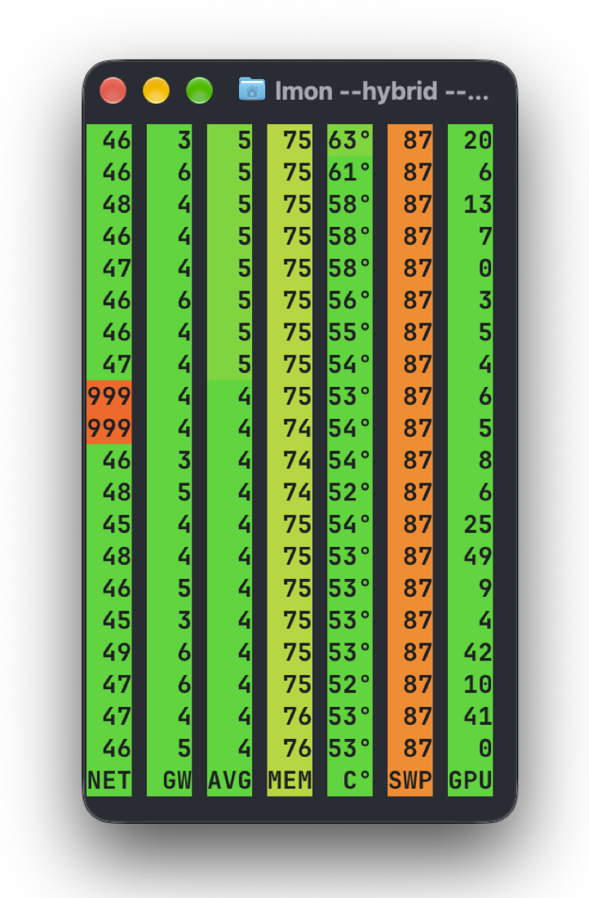
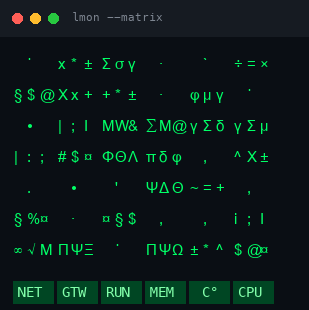
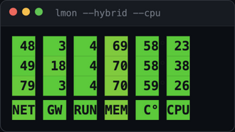
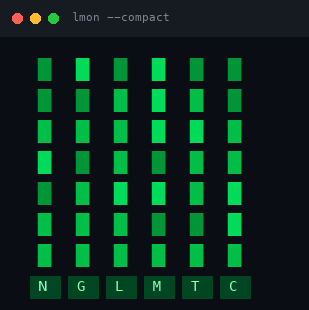

# lmon

**The pulse of your computer, in one line.**

**English** · [По-русски / Russian](README.ru.md) · [Website](https://martiyanov.github.io/lmon/)

<p align="center">
  <a href="https://martiyanov.github.io/lmon/"></a>
  &nbsp;
  <a href="https://martiyanov.github.io/lmon/"></a>
  &nbsp;
  <a href="https://martiyanov.github.io/lmon/"></a>
  &nbsp;
  <a href="https://martiyanov.github.io/lmon/"></a>
</p>
<p align="center"><sub>Six display modes — plain digits, color blocks (<code>--bars</code>), hybrid (<code>--hybrid</code>), compact (<code>--compact</code>), horizontal (<code>--horizontal</code>) and matrix/rain (<code>--matrix</code>, <code>--rain</code>) — real values captured on macOS. The window can shrink to the width of the indicators:</sub></p>
<p align="center">
  <a href="https://martiyanov.github.io/lmon/"></a>
</p>

Ever want to just know your machine is okay — without opening a task
manager or giving half your screen to graphs? lmon answers that with
one line per second. Color carries the status: green means calm,
red means look. You don't even need to read the numbers — a glance is
enough, which is why the header ribbon is pinned to the bottom and
painted with each column's current state.

A stream of measurements — ping to the internet, ping to your gateway,
CPU load and usage, memory, swap, CPU temperature and disk usage — colored
green / yellow / red so you can spot trouble at a glance.

The header is pinned to the bottom; each label sits on a background
colored by that column's current state, so the status line stays
readable even in a 2-line window:

```
 12   2  18   1  62  55  47  12   ← values stream upward
 11   2  19   1  63  55  47  12
118   3  21   1  63  56  47  12   ← Wi-Fi hiccup, gateway is fine → uplink
NET GTW CPU RUN MEM  C° DSK SWP   ← pinned header, background = state
```

Single static binary for **macOS**, **Linux** and **Windows 10+**
(amd64/arm64), written in Go. The original zsh version is kept in
[legacy/](legacy/lmon.zsh). Design principles: see
[CONCEPT.md](CONCEPT.md).

## Install

**macOS (Homebrew)**:

```sh
brew install martiyanov/tap/lmon
```

**macOS** (без Homebrew, Apple Silicon):

```sh
curl -fsSL https://github.com/martiyanov/lmon/releases/latest/download/lmon_darwin_arm64.tar.gz | tar -xz
sudo mv lmon /usr/local/bin/
```

On an Intel Mac use `lmon_darwin_amd64.tar.gz`.

**Debian / Ubuntu** (and other `.deb` systems):

```sh
curl -fsSLO https://github.com/martiyanov/lmon/releases/latest/download/lmon_amd64.deb
sudo dpkg -i lmon_amd64.deb
```

On ARM machines use `lmon_arm64.deb`. Fedora/RHEL: pick the `.rpm` asset
from the [releases page](https://github.com/martiyanov/lmon/releases).

**Other Linux**:

```sh
curl -fsSL https://github.com/martiyanov/lmon/releases/latest/download/lmon_linux_amd64.tar.gz | tar -xz -C /tmp
sudo mv /tmp/lmon /usr/local/bin/
```

**Windows 10+** (PowerShell):

```powershell
curl.exe -fsSL -o lmon.zip https://github.com/martiyanov/lmon/releases/latest/download/lmon_windows_amd64.zip
Expand-Archive lmon.zip; Move-Item lmon\lmon.exe "$env:LOCALAPPDATA\Microsoft\WindowsApps" -Force
```

(then run `lmon` in Windows Terminal; on ARM use `lmon_windows_arm64.zip`).
On Windows the `L` (load average), `T` (CPU temperature) and `I` (iowait)
columns are hidden automatically — the OS has no such readings. `SWP` reads
the page file through PDH (no admin), `GPU`/`G°` use NVIDIA NVML/nvidia-smi
or PDH GPU Engine counters (other vendors). CPU temperature has no native
API: pass `--temp-cmd` (e.g. LibreHardwareMonitor via PowerShell) to show
`C°`. At startup lmon says what was hidden or unavailable and how to fix it;
hints never block the run and can be turned off with `--no-hints`.

### Diagnostics on Windows

If a column shows `·` or `999`, run these in PowerShell and attach the output to a bug report:

```powershell
lmon --version
lmon --once --cols NGSPH --swap --gpu --gputemp

# is the --temp-cmd wiring alive? (expect 55)
lmon --once --cols T --temp-cmd "echo 55"

# swap / page file
Get-CimInstance Win32_PageFileUsage | Select-Object Name, AllocatedBaseSize, CurrentUsage

# network and gateway
ping -n 2 -w 1000 8.8.8.8
(Get-NetRoute -DestinationPrefix 0.0.0.0/0 | Sort-Object RouteMetric | Select-Object -First 1).NextHop

# GPU: NVIDIA driver tools, then WDDM counters (any vendor)
nvidia-smi --query-gpu=temperature.gpu,utilization.gpu --format=csv,noheader
Get-Counter '\GPU Engine(*)\Utilization Percentage' -ErrorAction SilentlyContinue

# disk pressure (counter names are localized on non-English Windows)
typeperf "\PhysicalDisk(_Total)\Avg. Disk Queue Length" -sc 3
typeperf "\PhysicalDisk(_Total)\Avg. Disk sec/Read" -sc 3

# CPU temperature sources (optional; often needs admin / may be unsupported)
Get-CimInstance -Namespace root/wmi -ClassName MSAcpi_ThermalZoneTemperature
```

What the values mean:

- **`SWP`** — page file usage, %. `·` means the page file is disabled or unreadable: enable it in `sysdm.cpl` → Advanced → Performance → Virtual memory.
- **`GPU`** — NVIDIA via NVML/nvidia-smi, AMD/Intel via PDH GPU Engine counters; `·` means no driver/source.
- **`G°`** — NVIDIA only for now; AMD/Intel need an external monitor.
- **`C°`** — no native Windows API; pass `--temp-cmd` (LibreHardwareMonitor, HWiNFO, ACPI WMI, any command printing °C).
- **`NET`/`GTW = 999`** — ICMP echo is not getting through; the startup hint shows the firewall rule and `--target`/`--gw` options.
- **`RUN` and `IOW`** are hidden on Windows on purpose: the OS has no load average and no iowait.

Also include your Windows version, GPU vendor and whether `nvidia-smi` exists — that is enough to reproduce most reports.

**If you have Go 1.22+**:

```sh
go install github.com/martiyanov/lmon@latest
```

All binaries are static, no dependencies beyond the system `ping`.

**Requirements:** the system `ping` utility (used as-is, no root needed).
On macOS the temperature column additionally needs
[`smctemp`](https://github.com/holtmann/osx/tree/master/smctemp)
(optional — without it the column shows `·` and lmon suggests installing it).
On Linux the temperature is read from
sysfs (`hwmon` / `thermal_zone`), no extra tools required.

## Usage

```sh
lmon                    # run forever, one line per second
lmon 20                 # print 20 lines and exit
lmon --bars                 # color blocks instead of digits
lmon --matrix               # green cipher matrix, no digits
lmon --rain --matrix        # same, values fall down
lmon --config ~/.config/lmon/config  # explicit config
lmon --save-config      # save current settings and exit
lmon --no-hints         # start without hints about hidden columns
lmon help               # built-in reference (English; Russian via --lang ru
                        # or automatically on a Russian locale)
lmon --version          # version
```

### Columns

Default set: **NET GTW CPU RUN MEM C° DSK SWP**. Extra columns are enabled with flags:

Column letters are used in `--cols`; headers are three letters wide and
align exactly with the values. In plain words:

- **NET** — how fast the internet answers (ping to 8.8.8.8), ms.
- **GTW** — how fast your router answers. Both NET and GTW red — trouble at
  home (Wi-Fi, router, cable); only NET red — trouble at the provider.
- **RUN** — how many programs on average are queuing for the CPU (the
  classic "load average"). Up to 4 is calm, more means the machine is
  overloaded with work. Hidden on Windows (no such reading).
- **MEM** — used memory, %. Red MEM with a growing SWP — memory is short,
  things start to slow down.
- **C°** — CPU temperature. Above 80–90 °C it is overheating.
- **CPU** — how busy the processor is right now, %.
- **IOW** — how much the CPU idles waiting for the disk (`--iowait`,
  Linux only; high — the disk is the bottleneck; hidden on macOS/Windows).
- **SWP** — swap/pagefile in use; grows when memory runs out. On Windows it reads the page file through PDH, no admin needed.
- **FAN** — fan speed, % (`--fans`; Linux: hwmon PWM outputs + NVIDIA GPU fan; other OS need external tools).
- **GPW** — GPU power, W (`--gpu-power`; Linux/NVIDIA).
- **NVM** — NVMe temperature, °C (`--nvme`; Linux).
- **LAT/QUE** — disk latency (ms) and I/O queue (`--disk-io`; Linux).
- **RX/TX/ERR** — network KB/s and errors/drops per second (`--net-rate`; Linux/macOS).
- **PSI** — memory pressure, avg10 % (`--psi`; Linux).
- **SVC/UPD** — failed systemd units and reboot-required flag (`--system`; Linux).
- **PWR/WEA** — CPU package power (RAPL) and NVMe wear (SMART), `--cpu-power`/`--nvme-smart`; Linux, require root.
- **I/O** — how busy the disk is, % (`--disk-busy`; Windows reads
  `\PhysicalDisk(_Total)\% Disk Time` via PDH, macOS derives it from IOKit
  `Total Time (Read/Write)`; no admin). The closest thing to Linux iowait.
- **DSK** — how full the system disk is; above 90% — time to clean.
- **BAT** — battery charge (`--batt`; red below 20%).
- **GPU** — how busy the video card is, % (`--gpu`). Windows: NVML/nvidia-smi (NVIDIA) or PDH GPU Engine counters (other vendors). Several cards: `--gpu-list` shows indexes; `--gpu-index N` picks one for `GPU`/`G°`, while `--gpu-index 0,1 --gpu --gputemp` adds a column per card (`G0/G1`, `T0/T1`).
- **G°** — GPU temperature (`--gputemp`; hidden on macOS/Windows — no
  unprivileged source).

`...` in the TUI (or `999` in `--once`; add `--symbols` to get `...` there too) — the host is not answering, `·` — the sensor exists but is
unavailable right now (e.g. TMP without `smctemp`), `+++` — the value did
not fit the column. Columns that the OS cannot provide at all are hidden.

Thresholds (green ≤ / yellow ≤ / red beyond):

| Id | Green | Yellow | Red |
|----|-------|--------|-----|
| `N` NET | ≤ 50 ms | ≤ 150 ms | > 150 |
| `G` GTW | ≤ 10 ms | ≤ 50 ms | > 50 |
| `L` RUN | ≤ cores | ≤ 2× cores | > 2× cores |
| `M` MEM | ≤ 60 | ≤ 85 | > 85 |
| `T` C° | ≤ 60 | ≤ 75 | > 75 |
| `C` CPU | ≤ 50 | ≤ 80 | > 80 |
| `I` IOW | ≤ 5 | ≤ 20 | > 20 |
| `S` SWP | ≤ 30 | ≤ 70 | > 70 |
| `U` DSK | ≤ 80 | ≤ 90 | > 90 |
| `K` I/O | ≤ 60 | ≤ 85 | > 85 |
| `B` BAT | ≥ 50 | ≥ 20 | < 20 |
| `P` GPU | ≤ 50 | ≤ 85 | > 85 |
| `H` G° | ≤ 60 | ≤ 80 | > 80 |

RUN thresholds scale with the machine's core count (load average is a queue
length: "all cores busy" is still green). Override any column with
`--thresholds NET=100/200/500,RUN=8/16/32` — handy on mobile internet.

### Ping any host as a column

`--ping NAME=host` adds your own ping column (2–3 char name) — e.g. the
server inside your VPN tunnel: `--ping VPN=10.8.0.1`. While the tunnel is
up you get its latency; VPN down — the column shows `...` (TUI) or `999` (`--once`). Repeatable,
or via `LMON_PING="VPN=10.8.0.1,DNS=1.1.1.1"`.

By default the column is appended on the right. To place it anywhere, add
the name to `--cols`: `--cols NG,VPN,M` puts the VPN ping between the
gateway and memory. Separators are required around ping names (commas,
spaces or `+`); compact column sets like `NGM` still work.

### Root-only metrics

`PWR` (CPU package power from RAPL) and `WEA` (NVMe wear from SMART) need root:

```sh
sudo lmon --cpu-power --nvme-smart
```

Without root lmon shows `·` in those columns and prints a hint:
`PWR: root required.` / `WEA: root required.` This is deliberate: the
metrics are shown, but lmon tells you why they are empty. `--all` includes
them, so `sudo lmon --all` is the full picture.

### All columns at once

`lmon --all` enables every column this OS can provide (CPU, swap, disk, battery,
GPU, I/O, pings from `--ping`) and silently drops what the OS does not expose.
It cannot be combined with `--cols`; with `--gpu-index 0,1` you get one GPU
block per card (`G0`, `G1`, `T0`, `T1`).

### Matrix style

`--matrix` works with any display mode: colors become green and values become
cipher glyphs instead of digits.

```sh
lmon --matrix              # normal grid, no digits
lmon --bars --matrix
lmon --hybrid --matrix
lmon --compact --matrix    # one glyph per parameter
lmon --horizontal --matrix
lmon --rain --matrix       # falling matrix values
```

In the normal grid each value is **three different glyphs**; the zero level
is a small random symbol centered in the cell: `·`, `.`, `,`, `'`, `` ` ``,
`˙`, `∙`. `--compact` and `--horizontal` use one glyph; `--rain` keeps
the width of the selected mode (three glyphs in the normal grid). At startup
lmon chooses a random slice of a safe single-cell glyph set (ASCII, Greek,
common math/geometric symbols); the set avoids wide, combining and control
characters. The exact font still decides whether a glyph is drawn or shown as
a box.

Digit-free, same bright green for every glyph; repeats inside one value are
avoided. Reels: [Russian `media/reel-benefit-ru.mp4`](media/reel-benefit-ru.mp4) · [English `media/reel-benefit-en.mp4`](media/reel-benefit-en.mp4) · [matrix teaser](media/reel-matrix.mp4).

### Rain direction

`--rain` is not a separate display mode: it only flips the direction. Header
stays on top, new values appear under it and fall down; symbols and colors
are exactly those of the selected mode.

```sh
lmon --rain          # digits fall down
lmon --rain --bars
lmon --rain --hybrid
lmon --rain --compact
lmon --rain --matrix # falling matrix glyphs
```

`--rain` cannot be combined with `--horizontal` or `--once`. Rendered rows are
frozen once created — they do not change while falling.

### Horizontal timeline

`--horizontal` turns the view 90°: one row per parameter, time flows to the
right, each cell is a colored block. No digits.

```sh
lmon --horizontal
lmon --horizontal --labels full
```

- newest sample is on the left, older samples move right;
- short labels are the `--cols` letters, `--labels full` gives names like
  `Network`, `Memory`, `CPU temp`;
- only rows that fit the terminal height are shown;
- purple = no sensor, bright red = no reply;
- TUI only; `--once` cannot be combined with `--horizontal`.

### Compact mode

<p align="center"></p>

`lmon --compact` is the narrowest view: one letter per parameter in the
header and one colored block `█` per value, with no spaces between columns.
The header uses the same letters as `--cols`; pings and multi-letter columns
(`PW`, `WR`) show their first character. Purple means no sensor, bright red
means no reply. It fits tmux/status bars and can be combined with the other
styles:

```sh
lmon --compact --cols NGM
lmon --compact --matrix     # cipher glyphs instead of blocks
lmon --rain --compact       # values fall down
```

With `--matrix` the single cell shows a cipher glyph; the zero level is a
small centered symbol. With `--rain` the same compact cells fall down.

### Bars and hybrid

`lmon --bars` (`--blocks` is a legacy alias) replaces digits with colored
squares `███`: one per column, with a continuous green → yellow → red gradient
along each column's scale. In color mode a purple block means no sensor on
this machine and a bright red block means the host is unreachable — no `·` or
`...` characters are printed. Without color (`NO_COLOR`, pipe) the text
fallbacks stay.

`lmon --hybrid` combines both: exact digits printed on the state-colored
background.

## JSON, exit codes and processes

For scripts and cron:

```sh
lmon --once --json          # machine-readable columns
lmon --once --exit-code     # 0 = ok, 1 = warning, 2 = critical
lmon --top 10               # top processes by CPU (Unix)
```

JSON is one object per sample; `state` is `ok`, `warning`, `critical`,
`no_sensor` or `no_reply`, and `value` is `null` when there is no reading.
`--exit-code` works only with `--once`; `--top` is Unix-only for now.

Presets choose a sensible column set:

```sh
lmon --profile server
lmon --profile desktop
lmon --profile network
```

An explicit `--cols` or config `cols` wins over a profile.

## Config

lmon reads a small `key=value` file before CLI flags:

```sh
lmon --save-config
lmon --config ./lmon.conf --once
lmon --no-config
```

Default path: `$XDG_CONFIG_HOME/lmon/config` or `~/.config/lmon/config`
(Windows: `%AppData%\lmon\config`). `LMON_CONFIG` overrides it.
Precedence: CLI flags > config file > environment > defaults.

```ini
cols=NGCLMTUS
interval=1
no-hints=true
ping=VPN=10.8.0.1
```

## No color

Color is disabled with the standard `NO_COLOR=1 lmon` or `--mono`. In
`--compact`/`--bars` lmon automatically switches to a monochrome fill ramp:

```
· → ░ → ▒ → ▓ → █
```

No sensor is `?`/`???`, no reply is `!`/`!!!`. There is no separate
`--no-color` flag yet; use `NO_COLOR=1` or `--mono`.

### TUI: header leads by one sample

In the TUI the pinned header always shows the **current** sample, while the
data row directly above it is one sample older. A color change appears first
in the header and moves upward on the next tick instead of lighting the
header and the cell above it at the same time. `--once` is unchanged.

### Reading bad numbers

- NET and GTW red together — local problem: Wi-Fi, router, cable.
  Only NET red — the uplink or your provider.
- RUN high while CPU is low — the system waits (disk, network, locks)
  rather than computes; high IOW confirms it's the disk (Linux).
- MEM red and SWP growing — out of memory, swapping started; everything
  slows down.
- CPU ≈ 100 for a long time — a process is eating the CPU; find it
  with `top`.
- C° > 80–90 °C — overheating/throttling: dust, fans, sustained load.
- DSK > 90 — the disk is nearly full; the system misbehaves.

### Options (flags and environment variables)

| Flag | Env | Default | Description |
|------|-----|---------|-------------|
| `--target` | `LMON_TARGET` | `8.8.8.8` | external host: IPv4, DNS name or an IPv6 literal (e.g. `fe80::1%en0`; the gateway follows the same address family) |
| `--gw` | `LMON_GW` | auto-detect | your gateway |
| `--interval` | `LMON_INTERVAL` | `1` | seconds between lines (fractional ok) |
| `--bars` | — | off | colored bars instead of digits (`--blocks` is a legacy alias) |
| `--compact` | `LMON_COMPACT` | off | one letter and one colored block per parameter, no gaps |
| `--horizontal` | `LMON_HORIZONTAL` | off | horizontal color timeline (TUI) |
| `--rain` | `LMON_RAIN` | off | direction: new values on top, falling down (works with the selected mode) |
| `--matrix` | `LMON_MATRIX` | off | matrix style: green, no digits, random safe cipher glyphs, zero = small centered symbol (any mode) |
| `--mono` | `LMON_MONO` | off | monochrome fill (`· ░ ▒ ▓ █`); also automatic with `NO_COLOR` |
| `--labels` | `LMON_LABELS` | `short` | horizontal labels: `full` or `short` |
| `--hybrid` | — | off | digits on the state-colored background |
| `--cols` | `LMON_COLS` | base set | column set and order: letters (`NG,CSB`), `--ping` names (`NG,VPN,M`), and an empty column for two commas (`NG,,M`); flags add more |
| `--profile` | `LMON_PROFILE` | off | column preset: `server`, `desktop`, `network` |
| `--json` | `LMON_JSON` | off | JSON output for `--once` and `--top` |
| `--exit-code` | `LMON_EXIT_CODE` | off | with `--once`: exit 1 warning, 2 critical |
| `--top` | `LMON_TOP` | off | show top N processes by CPU and exit (Unix) |
| `--config` | `LMON_CONFIG` | XDG path | read settings from `key=value` file |
| `--save-config` | — | off | save current settings to the config file and exit |
| `--no-config` | — | off | do not read the config file |
| `--once` | — | off | print one line of values and exit; colored only on a terminal (tmux/scripts get plain text) |
| `--temp-cmd` | `LMON_TEMP_CMD` | — | external command printing CPU temp in °C (e.g. LibreHardwareMonitor via PowerShell on Windows) |
| `--disk-busy` | `LMON_DISK_BUSY` | off | disk busy time %: Windows PDH `PhysicalDisk`, macOS IOKit |
| `--symbols` | `LMON_SYMBOLS` | off | in `--once`, show `...` instead of `999` for “no reply” |
| `--gpu-index` | `LMON_GPU_INDEX` | `0` | GPU index or list (`0,1`) for `--gpu`/`--gputemp`; a list adds one column per card (`G0/G1`, `T0/T1`) |
| `--gpu-list` | `LMON_GPU_LIST` | off | list available GPUs and exit |
| `--all` | `LMON_ALL` | off | every column the OS can provide, plus `--ping` columns; incompatible with `--cols` |
| `--fans` | `LMON_FANS` | off | fan speed, % (Linux: hwmon PWM + NVIDIA GPU fan) |
| `--fans-all` | `LMON_FANS_ALL` | off | one column per fan (`F1…`, `GF` for GPU) |
| `--fans-list` | `LMON_FANS_LIST` | off | list fans and exit |
| `--gpu-power` | `LMON_GPU_POWER` | off | GPU power, W (Linux/NVIDIA) |
| `--nvme` | `LMON_NVME` | off | NVMe temperature, °C (Linux) |
| `--disk-io` | `LMON_DISK_IO` | off | disk latency and queue (Linux) |
| `--net-rate` | `LMON_NET_RATE` | off | RX/TX KB/s and errors (Linux/macOS) |
| `--psi` | `LMON_PSI` | off | memory pressure (Linux) |
| `--system` | `LMON_SYSTEM` | off | failed units and reboot-required (Linux) |
| `--cpu-power` | `LMON_CPU_POWER` | off | CPU package power, W (Linux, root/RAPL) |
| `--nvme-smart` | `LMON_NVME_SMART` | off | NVMe wear, % (Linux, root/SMART) |
| `--cpu` `--iowait` `--swap` `--disk` `--batt` `--gpu` `--gputemp` | — | off | add extra columns |

```sh
lmon --target 1.1.1.1 --interval 2 10
lmon --bars --cols TNGC --cpu          # own set and order, flags add more
lmon --cols NG,,M                      # empty spacer between G and M
lmon --ping VPN=10.8.0.1 --cols NG,VPN,M  # place a ping column anywhere
lmon --gpu-list                    # 0: RTX 3060, 1: Intel UHD
lmon --gpu --gputemp --gpu-index 0 # show a specific GPU
lmon --gpu --gputemp --gpu-index 0,1 # one column per GPU
lmon --fans                         # fan speed % (Linux)
lmon --fans-all                     # one column per fan
lmon --gpu-power --nvme --disk-io --net-rate --psi --system
lmon --cpu-power --nvme-smart  # root-only metrics
lmon --all                          # all supported columns at once
tmux: set -g status-right '#(lmon --once --cols=NGMC)'
```

The first line after start may show an inflated ping: the Wi-Fi radio
needs to wake up. Values settle after that.

## How it works

Ping runs through the system `ping` binary (flags adapted per OS), so no
privileges are required. Load average comes from the kernel (`sysctl` on
macOS, `/proc/loadavg` on Linux). Memory: `vm_stat` on macOS,
`/proc/meminfo` on Linux. GPU: `ioreg` on macOS, `nvidia-smi`/sysfs on
Linux. Colors respect `NO_COLOR`.

## A beginner-friendly Russian README

Установка и объяснения для тех, кому проще по-русски: [README.ru.md](README.ru.md).

## Community

- **GitHub Discussions** — ideas, questions, setups, release announcements: https://github.com/martiyanov/lmon/discussions
- Rules and how an idea becomes a feature: [COMMUNITY.md](COMMUNITY.md)
- Bugs and concrete tasks: [Issues](https://github.com/martiyanov/lmon/issues)
- Security reports: privately via [Security → Report a vulnerability](https://github.com/martiyanov/lmon/security/advisories/new)

Russian and English are both welcome. Answers worth keeping stay in Discussions so they remain searchable; Matrix/Telegram chat links will be added here once the rooms are created.

## License

[MIT](LICENSE)
