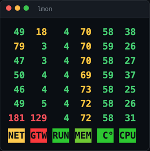
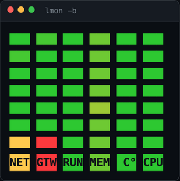
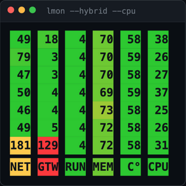
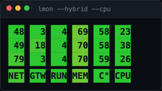

# lmon — монитор компьютера в терминале

**[English](README.md)** · Русский · [Сайт с живой демкой](https://martiyanov.github.io/lmon/)

<p align="center">
  <a href="https://martiyanov.github.io/lmon/"></a>
  &nbsp;
  <a href="https://martiyanov.github.io/lmon/"></a>
  &nbsp;
  <a href="https://martiyanov.github.io/lmon/"></a>
</p>
<p align="center"><sub>Три режима — цифры, цветные квадраты (<code>-b</code>) и гибрид (<code>--hybrid</code>); значения настоящие, снятые на macOS. Окно можно ужать до ширины индикаторов:</sub></p>
<p align="center">
  <a href="https://martiyanov.github.io/lmon/"></a>
</p>

Хочется просто видеть, всё ли с компьютером в порядке — не открывая
диспетчер задач и не отдавая полэкрана графикам. lmon показывает это
одной строкой в секунду. Цвет говорит о состоянии: зелёный — всё
спокойно, жёлтый — стоит взглянуть, красный — что-то не так. Цифры
не обязательны: статус читается боковым зрением.

```
 12   2   1  62  55       ← значения стекаются вверх
 11   2   1  63  55
118   3   1  63  56       ← интернет «моргнул»: роутер в норме, значит виноват канал
NET  GTW RUN MEM  C°       ← закреплённая лента; подложка подписи = цвет состояния
```

Работает на macOS, Windows 10+ и Linux. Одна небольшая программа,
ничего extra ставить не нужно. Принципы проекта — в
[CONCEPT.md](CONCEPT.md): легко, мало ресурсов, честно (нет датчика —
покажет точку «·», а не выдуманное число).

## Установка

### macOS

1. Открой «Терминал»: `Cmd + Пробел` → набери «Терминал» → Enter.
2. Скопируй две команды по одной (после каждой — Enter):

```sh
curl -fsSL https://github.com/martiyanov/lmon/releases/latest/download/lmon_darwin_arm64.tar.gz | tar -xz
```

```sh
sudo mv lmon /usr/local/bin/
```

Вторая команда спросит пароль от мака — набери его (при наборе пароль
не виден, это нормально).

> Старый мак на Intel? В первой команде возьми `lmon_darwin_amd64.tar.gz`.

Есть Homebrew? Тогда всё в одну команду: `brew install martiyanov/tap/lmon`.

### Windows 10/11

1. Правый клик по «Пуск» → «Терминал» (или PowerShell).
2. Скопируй по очереди:

```powershell
curl.exe -fsSL -o lmon.zip https://github.com/martiyanov/lmon/releases/latest/download/lmon_windows_amd64.zip
```

```powershell
Expand-Archive lmon.zip
Move-Item lmon\lmon.exe "$env:LOCALAPPDATA\Microsoft\WindowsApps" -Force
```

3. Набери `lmon` и жми Enter.

> Синее окно SmartScreen — стандартное предупреждение о незнакомой
> программе: «Подробнее» → «Выполнить в любом случае». Код открыт:
> [github.com/martiyanov/lmon](https://github.com/martiyanov/lmon).

### Linux

Debian/Ubuntu: `curl -fsSLO .../lmon_amd64.deb && sudo dpkg -i lmon_amd64.deb`
(полная команда в [английском README](README.md)). Остальные
дистрибутивы: curl + tar, как на маке.

## Проверка

```sh
lmon 5      # пять строк и выход — значит, работает
lmon help   # вся справка: при русской локали — по-русски,
            # иначе lmon --lang ru help (или lmon help ru)
```

## Что означают колонки

Простыми словами:

- **NET** — как быстро отвечает интернет (пинг до 8.8.8.8), в миллисекундах.
- **GTW** — как быстро отвечает твой роутер. Вместе с NET помогает понять,
  где проблема: обе красные — плохо дома (Wi-Fi, роутер, кабель);
  красный только NET — плохо у провайдера.
- **RUN** — сколько программ в среднем стоит в очереди к процессору
  (это классический «load average»). Цвет считается по числу ядер
  конкретной машины: пока очередь не длиннее числа ядер — зелёный,
  до двух ядер очереди — жёлтый, дальше красный. Пороги любой колонки
  можно задать свои: `--thresholds NET=100/200/500,RUN=8/16/32` —
  удобно, например, на мобильном интернете. На Windows такого
  показателя нет — будет точка.
- **MEM** — сколько занято памяти, %. Красная MEM и растущий SWP — памяти
  не хватает, всё начинает тормозить.
- **C°** — температура процессора. Выше 80–90 °C — перегрев.
- **CPU** — насколько процессор занят прямо сейчас, % (`--cpu`).
- **IOW** — сколько процессор простаивает в ожидании диска (`--iowait`,
  только Linux; высокий — диск узкое место).
- **SWP** — занятый файл подкачки (`--swap`; растёт при нехватке памяти).
- **DSK** — насколько заполнен системный диск (`--disk`; выше 90% — пора чистить).
- **BAT** — заряд батареи (`--batt`; красный ниже 20%).
- **GPU** — занятость видеокарты, % (`--gpu`).
- **G°** — температура видеокарты (`--gputemp`; на macOS/Windows без прав
  администратора недоступна — честная точка).

`999` — хост не отвечает, `·` — такого датчика в системе нет,
`+++` — число не влезло в колонку.

Три режима отображения на вкус: просто цифры (`lmon`), цветные
квадраты без цифр (`lmon -b`), цифры на цветной подложке (`lmon --hybrid`).
Набор и порядок колонок — любые: `lmon --cols NRMC` (буквы — в `lmon help`).
Одна строка значений для tmux-статусбара: `lmon --once`.

## FAQ

**Спросил пароль (`sudo`) — это что?** Твой пароль учётной записи; не
отображается при вводе — так устроено. Нужен, чтобы положить программу
в системную папку.

**«command not found» после установки.** Закрой терминал и открой заново.
Не помогло — прогони установку ещё раз и посмотри красные ошибки.

**Хочу температуру процессора на macOS.** Поставь маленькую утилиту
smctemp: https://github.com/holtmann/osx/tree/master/smctemp — без неё
в колонке C° будет точка.

**Первая строка подозрительно большая.** Wi-Fi «просыпается» при старте;
со второй строки — честные числа.

## Как удалить

macOS/Linux: `sudo rm /usr/local/bin/lmon` (или
`brew uninstall martiyanov/tap/lmon`).
Windows: удали `lmon.exe` из `C:\Users\<имя>\AppData\Local\Microsoft\WindowsApps`.

## Лицензия

MIT — используй и меняй свободно. Код:
[github.com/martiyanov/lmon](https://github.com/martiyanov/lmon).
